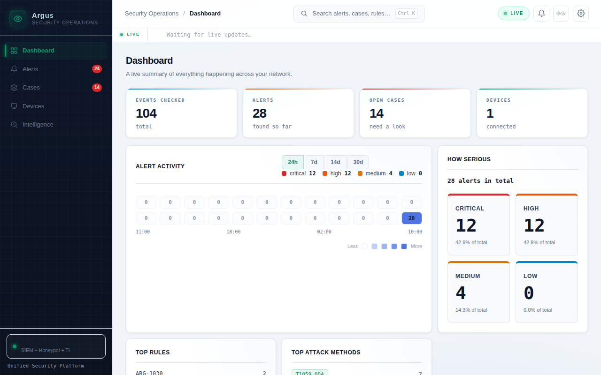
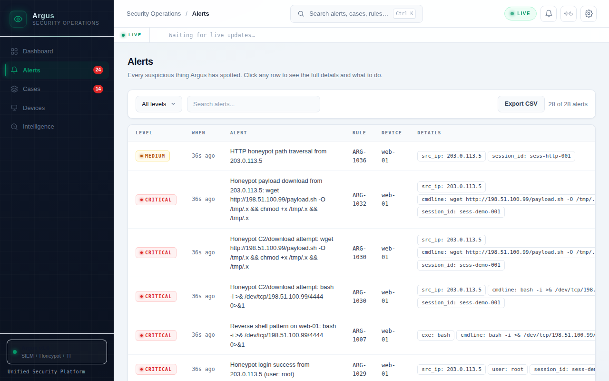
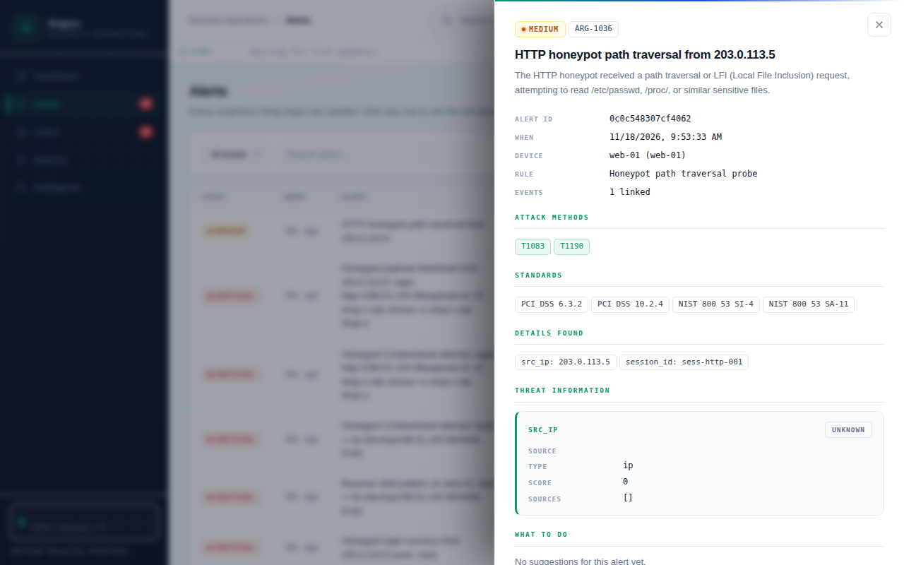
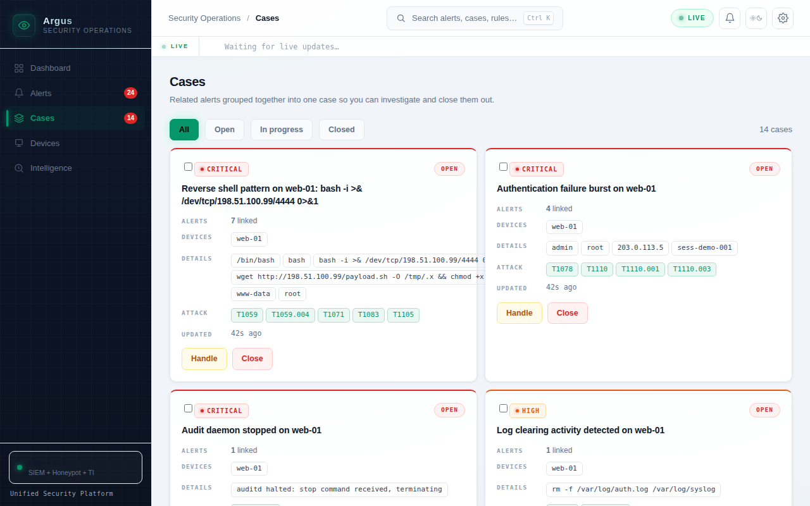
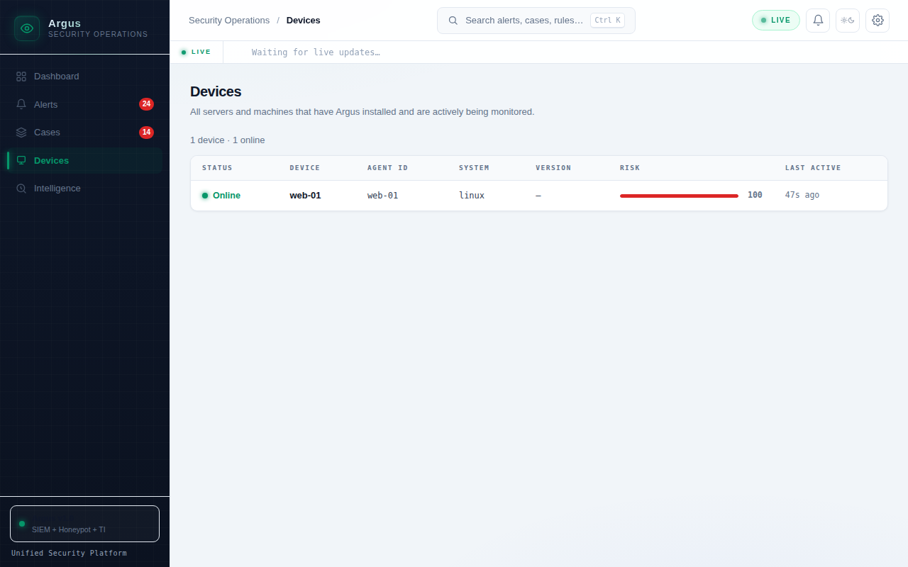
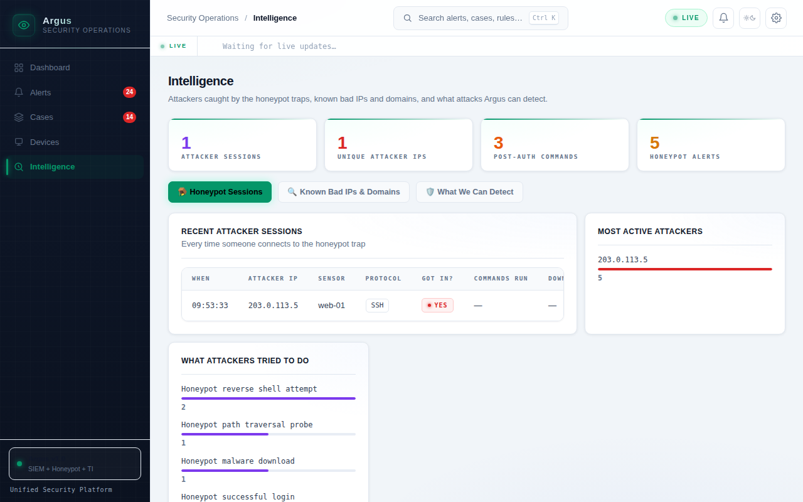

# Argus: Open-Source Security Monitoring for Your Lab

Argus watches your computers, spots attacks, groups them into cases you can
work through, fights back on its own, and sets traps to catch attackers.
One server, one dashboard, one API key. Built for learning, home labs, and
small setups.



> **Honest scope:** Argus is a single-computer lab and demo tool. It is not
> a replacement for Wazuh or a commercial SIEM, and it is not production
> software. It is a complete, working system you can run, study, and extend.

## What is Argus?

Argus has three parts that work together:

1. **Watch (SIEM/XDR).** A small program called an *agent* runs on each
   computer you monitor. It reads login attempts, commands, file changes,
   and network connections, and sends them to the server. The server checks
   every event against 36 detection rules, learns normal behavior, and
   raises an alert when something looks like an attack.
2. **Trap (honeypot).** A fake SSH server and a fake website that look real
   to an attacker. Every login try and every command is recorded, and
   download links the attacker uses are saved as threat intel.
3. **Check (threat intel).** A database of known bad IPs, domains, URLs,
   and file hashes, refreshed every hour from 5 public feeds. Every alert
   is checked against it, so you see at once if an address is already
   known to be bad.

Ideas in Argus are borrowed from two well-known open-source projects:
[Cowrie](https://github.com/cowrie/cowrie) (honeypot) and
[MISP](https://github.com/MISP/MISP) (threat intel sharing). Argus itself
is written from scratch in Python.

**Words used in this file:**

| Word | Plain meaning |
|---|---|
| SIEM | Software that collects logs and finds attacks in them |
| Alert | One suspicious thing Argus spotted |
| Case | A group of related alerts about one attack, to investigate together |
| Rule | An "if this happens, raise an alert" check, written in a YAML file |
| Playbook | An automatic response plan, for example "block the attacker IP" |
| IOC | A known bad IP, domain, URL, or file hash ("indicator of compromise") |
| MITRE ATT&CK | A public list of attacker methods, each with a code like T1110 |
| UEBA | Learning what "normal" looks like, then flagging strange behavior |
| Honeypot | A fake system that traps attackers and records what they do |
| STIX | A standard file format for sharing threat intel |

## What you see

The dashboard has 5 screens. All screenshots below are real, taken from
Argus running with demo attack data.

### Dashboard: the full picture at a glance


Total events checked, alerts found, open cases, and connected devices,
plus an activity chart and the top rules and attack methods.

### Alerts: everything Argus spotted



Every alert in one table. Filter by level, search by text, or export to
CSV. Click any row to open the full detail view:



The detail view shows what happened in plain words, the device, the rule,
the attack methods (MITRE codes), the standards it maps to (PCI DSS,
NIST), the evidence found, the threat intel verdict, and what to do next.

### Cases: alerts grouped into one investigation



Alerts about the same attacker, device, or file hash are grouped into one
case, so you investigate one attack instead of twenty separate alerts.
Handle a case, or close it when it is done.

### Devices: the computers being watched



Every machine with the Argus agent installed: online or offline, system
type, and a risk score based on its recent alerts.

### Intelligence: traps, bad addresses, and coverage



Three tabs: attacker sessions caught by the honeypot traps, known bad IPs
and domains from the threat intel database, and what attacks Argus can
detect.

## Start in 5 minutes

You need **Python 3.10 or newer** and a terminal. No other software is
needed for the basic run.

### Windows (Command Prompt)

```cmd
REM 1. Go to the folder where you put Argus (change the path to yours)
cd C:\Argus

REM 2. Install what Argus needs (first time only)
python -m pip install -r requirements.txt

REM 3. Start the server (leave this window running)
python -m uvicorn server.argus_app:app --port 8000
```

Open http://localhost:8000 in your browser. Click the **gear icon**, enter
the API key `argus-dev-key`, and click **Save & reconnect**. Without the
key, the dashboard shows 401 errors and no data.

### Linux and macOS (terminal)

```bash
# 1. Install what Argus needs (first time only)
python3 -m venv .venv
.venv/bin/pip install -r requirements.txt

# 2. Start the server (SIEM + threat intel on port 8000)
.venv/bin/uvicorn server.argus_app:app --port 8000
```

Then open http://localhost:8000 and enter the API key `argus-dev-key`
with the gear icon, as above.

### Add demo attack data (optional, recommended)

In a **second** terminal, in the same folder:

```bash
python simulator/simulate.py --all --server http://localhost:8000 --delay 0
```

This replays 10 attack scenarios (brute force, reverse shell, ransomware
behavior, honeypot attacks, and more). The dashboard fills with alerts
within seconds.

### Add the traps (optional)

In a **third** terminal, in the same folder:

```bash
python -m honeypot.honeypot_server --server http://localhost:8000 --api-key argus-dev-key --ssh-port 2222 --http-port 8080
```

Now attack your own trap to see it work:

```bash
ssh -o NumberOfPasswordPrompts=5 root@localhost -p 2222
```

Type any wrong password 3 times. The 4th try lets you into a fake Ubuntu
shell. Try `whoami`, `ls`, and `cat /etc/passwd`, then type `exit`.
After a few seconds, your session appears in the dashboard under
**Intelligence**, **Honeypot Sessions**, with every login try and command.

(The `-o NumberOfPasswordPrompts=5` part matters: plain `ssh` gives up
after 3 password tries, before the trap lets you in.)

### Ports used

| Port | What |
|---|---|
| 8000 | Dashboard + API (SIEM and threat intel) |
| 2222 | SSH trap |
| 8080 | HTTP trap (fake login pages) |

## Windows desktop app

Argus can run as a local Windows desktop app: double-click
`build_windows.bat`, wait for the build, extract
`dist\Argus-Windows.zip`, and run `Argus\Argus.exe`. The app starts the
server on a private local port, opens the dashboard in its own window, and
creates its own API key on first run (stored with the databases under
`%LOCALAPPDATA%\Argus`). No browser and no manual key entry needed.

To build it you need Windows, Python 3, and the Microsoft Edge WebView2
Runtime. The built app runs on a PC without Python, but WebView2 must be
installed there. The desktop app does not start the honeypot or the
simulator. This is early packaging, not a signed installer.

## Docker

```bash
# Full stack: server + honeypot
docker compose up --build -d

# Ports: 8000 dashboard, 2222 SSH trap, 8080 HTTP trap

# With attack scenarios demo:
docker compose --profile demo up simulator
```

## Deploy to Render

Argus is a Python FastAPI app with SQLite storage, so Render fits it
better than a static host. This repo includes `render.yaml`: push to
GitHub, connect the repo in Render, and deploy. Render reads the
entrypoint, health check, disk, and environment variables from the file.

What the file sets: `ARGUS_API_KEY` (generated by Render), `ARGUS_DB` and
`ARGUS_TI_DB` on a 1 GB persistent disk at `/data`, feed refresh every
hour, 30-day retention. Start command:
`uvicorn server.argus_app:app --host 0.0.0.0 --port $PORT`. Health check:
`/api/argus/health`.

Note: the persistent disk needs a paid Render plan, and Render asks for a
card before any deploy. Without the disk, SQLite data is lost whenever the
service restarts.

## How Argus works

```
                    +-------------------------------------------+
                    |   Argus Dashboard (port 8000)             |
                    |   Dashboard · Alerts · Cases · Devices    |
                    |   Intelligence                            |
                    +---------------+---------------------------+
                                    | REST + WebSocket (live)
              +---------------------+---------------------+
              |                     |                     |
    +---------v--------+  +---------v----------+  +-------v--------------+
    |  Argus SIEM/XDR  |  |  Threat Intel      |  |  Argus Honeypot      |
    |  /api/v1/*       |  |  /api/ti/v1/*      |  |  port 2222 (SSH)     |
    |                  |  |                    |  |  port 8080 (HTTP)    |
    |  Rule engine     |  |  IOC database      |  |                      |
    |  Behavior checks |  |  Feed downloads    |  |  Fake shell          |
    |  Alert triage    |  |  STIX/CSV export   |  |  Session recorder    |
    |  Case grouping   |  |  Enrichment        |  |  Ships events        |
    |  Playbooks       |  |  (5 default feeds) |  |  to the SIEM         |
    +---------+--------+  +---------+----------+  +----------------------+
              |                     |
              +---- checks bad -----+
                    lists first
```

Step by step, in plain words:

1. **Collect.** Agents on your computers and the honeypot traps send
   events (log lines, commands, connections) to the server.
2. **Detect.** The rule engine checks each event against 36 rules, and the
   behavior checks compare it against what is normal for that device.
3. **Alert.** A match creates an alert with a level (critical, high,
   medium, low), the rule that fired, and the evidence.
4. **Check.** The alert is looked up in the threat intel database. If an
   IP or domain is already known to be bad, the alert says so. If it is
   unknown, Argus says "unknown" and never guesses.
5. **Explain.** Triage writes a plain-words summary: what happened, how
   serious it is, and what to do. With an AI key set (Claude or GPT), an
   AI writes the summary; without one, the built-in explainer does it.
6. **Group.** Related alerts join into one case, so one attack is one
   piece of work.
7. **Respond.** Playbooks act automatically: block an IP, quarantine a
   file, isolate a device, or send a notification. Dangerous steps are
   limited by safety settings (see below).
8. **Show.** The dashboard updates live over WebSocket, so new alerts
   appear without refreshing the page.

## Part 1: Watching (SIEM/XDR)

### The agent

The agent is a small Python program with **no extra dependencies** (Python
standard library only). It runs on Linux and watches:

- Login attempts and sudo use (`auth` collector)
- New and changed files (`fim` file watcher)
- Running processes (`process` collector)
- Network connections (`netstat` collector)
- System log lines (`syslog` tail reader)

It sends events to the server in batches, stores them safely on disk if
the server is down, and retries later. It also runs response actions the
server asks for (block, quarantine, isolate) when they are allowed. Full
agent setup: [docs/AGENT.md](docs/AGENT.md).

### Detection rules: 36 checks

Rules live in `rules/` as simple YAML files. One rule looks like this:

```yaml
- id: ARG-1001
  name: SSH brute force
  severity: high
  mitre: [T1110.001]
  match:
    all:
      - field: event_type
        op: equals
        value: auth_failure
  threshold: {count: 5, window: 300, group_by: [src_ip]}
```

In plain words: "if one IP fails to log in 5 times within 5 minutes,
raise a high alert." Rules can also require another rule to have fired
first (for example, a successful login only counts as an attack if a
brute force happened just before). Write your own:
[docs/RULE_AUTHORING.md](docs/RULE_AUTHORING.md).

### Behavior checks (UEBA): 4 built-in checks

These are built into the server code, not YAML files. They learn what is
normal for each device and flag the strange:

| ID | What it spots | Level |
|---|---|---|
| ARG-9001 | Same user logged in from different IPs at the same time | high |
| ARG-9002 | A program never seen before, running from a strange folder | high |
| ARG-9003 | Login at an hour this user never logs in | medium |
| ARG-9004 | A burst of failed logins | high |

### Automatic responses: 9 playbooks

Playbooks live in `playbooks/` as YAML files. When their trigger fires,
their steps run:

| Playbook | Trigger | What it does |
|---|---|---|
| `block-ssh-bruteforce` | ARG-1001 | Block the attacker IP, notify |
| `auto-block-honeypot-attacker` | ARG-1029 | Block the IP, notify, send webhook |
| `honeypot-c2-response` | ARG-1030 | Block the IP, notify with command evidence |
| `quarantine-malware` | ARG-1008 | Quarantine the file, notify |
| `isolate-host` | Any critical alert | Notify only (isolation needs a rule trigger, for safety) |
| `notify-soc` | Any high alert | Send a notification |
| `snapshot-evidence` | Any critical alert | Save evidence (needs `ARGUS_ALLOW_RUN=1`) |
| `ti-enriched-block` | Any critical alert | Notify only (blocking needs a rule trigger, for safety) |
| `release-host` | Manual | Undo an isolation, notify |

Safety limits, on purpose: blocks never touch private or protected
addresses (set extra ones with `ARGUS_NEVER_BLOCK`); running commands on
a device is **off** unless the server is started with
`ARGUS_ALLOW_RUN=1`; and playbooks that fire on "any critical alert" only
notify, so a false alarm can never block or isolate anything by itself.

## Part 2: Traps (honeypot)

The honeypot is a fake system that attackers think is real. It is
inspired by Cowrie, written from scratch here.

### SSH trap (port 2222)

- Looks like a real Ubuntu server with a working shell: `ls`, `cat`, `ps`,
  `id`, `uname`, `wget`, `curl`, `python3`, `crontab`, and more.
- Lets the attacker in after 3 failed login tries, so real brute-force
  tools reach the shell.
- Records every login try, every command, and what the attacker seemed to
  be trying to do (looking around, downloading, staying hidden, getting
  higher access).
- Download links the attacker uses are saved as new threat intel.

### HTTP trap (port 8080)

- Pretends to be login pages (`/wp-login.php`, `/admin`) and config files
  (`/.env`).
- Spots and labels probes: login guessing, SQL injection, cross-site
  scripting, webshell uploads, path traversal, admin page hunting.

### Honeypot detection rules: 8 checks

| Rule | Level | What it detects |
|---|---|---|
| ARG-1029 | critical | Attacker got into the trap (this can never be a false alarm) |
| ARG-1030 | critical | Reverse shell or remote-control attempt in the trap |
| ARG-1031 | high | More than 10 recon commands in 5 minutes |
| ARG-1032 | critical | Attacker tried to download a file |
| ARG-1033 | high | Attacker tried to stay on the system (cron, keys, new user) |
| ARG-1034 | medium | Many login tries on the fake website |
| ARG-1035 | medium | SQL injection probes on the fake website |
| ARG-1036 | medium | Path traversal probes on the fake website |

**Safety:** run the traps on a private lab network only. Never expose
ports 2222 or 8080 to the internet.

## Part 3: Threat intel

The threat intel platform is a small database of known bad addresses,
inspired by MISP. It runs inside the same server and dashboard, on the
same port.

### Built-in feeds (refreshed every hour)

| Feed | What it lists | Format |
|---|---|---|
| Feodo Tracker C2 | Bad server IPs (botnet controllers) | text |
| URLhaus Malicious Domains | Malicious domains | text |
| OpenPhish Phishing URLs | Phishing web addresses | text |
| Emerging Threats Compromised IPs | Compromised IPs | text |
| MISP Warning Lists | Cloud address ranges to treat as clean | JSON |

Feeds are downloaded over HTTPS with size limits and safety checks, so a
bad feed address cannot make the server fetch internal addresses. You can
add your own feeds from the dashboard or the API.

### What you can do with it

- **Look up** any IP, domain, URL, or file hash: known bad, suspicious,
  clean, or honestly unknown.
- **Add your own** bad addresses, alone or in bulk.
- **Export** everything as STIX 2.1 (the standard sharing format) or CSV.
- **Automatic checks:** every alert is checked against the database
  before it reaches you.

```bash
# Look up two values
curl -H "X-API-Key: argus-dev-key" \
  -d '{"values":["203.0.113.5","evil.example.com"]}' \
  -H "Content-Type: application/json" \
  http://localhost:8000/api/ti/v1/iocs/lookup

# Sync all feeds now
curl -X POST -H "X-API-Key: argus-dev-key" \
  http://localhost:8000/api/ti/v1/feeds/run-all

# Export all malicious IOCs as STIX 2.1
curl -H "X-API-Key: argus-dev-key" \
  "http://localhost:8000/api/ti/v1/export/stix?reputation=malicious"
```

Optional extras, only if you add keys: AbuseIPDB and VirusTotal lookups,
and GreyNoise (off unless `ARGUS_GREYNOISE=1`).

## All 36 detection rules

Taken straight from the rule files. Levels: critical, high, medium.

```
Everyday attacks
ARG-1001  SSH brute force                              high
ARG-1002  SSH successful login after brute force      critical
ARG-1003  Sudo shell escalation attempt               high
ARG-1004  Sudoers configuration modified              high
ARG-1005  New local user account created              medium
ARG-1006  Webshell-like shell one-liner               critical
ARG-1007  Reverse shell pattern                       critical
ARG-1008  Executable launched from world-writable dir high
ARG-1009  Critical credential store modified          critical
ARG-1010  SSH daemon configuration changed            high
ARG-1011  Cron persistence modified                   high
ARG-1012  Outbound connection to uncommon port        medium
ARG-1013  Large outbound data transfer                high
ARG-1014  Possible DNS tunneling                      high
ARG-1015  Audit daemon disabled or stopped            critical
ARG-1016  Security logs cleared or truncated          high
ARG-1017  Kernel module loaded                        high
ARG-1018  Container escape via Docker socket          critical
ARG-1019  Credential dumping tool keywords            critical
ARG-1020  Ransomware-like mass file modification      critical
ARG-1021  Privilege escalation via su to root         high
ARG-1022  Systemd persistence service created         high
ARG-1023  SSH authorized_keys modified                high
ARG-1024  SSH password spraying                       high
ARG-1025  Systemd timer persistence created           high
ARG-1026  Shell spawned by web service account        critical
ARG-1027  Hosts file modified                         high
ARG-1028  SSH login at unusual hour                   medium

Honeypot attacks
ARG-1029  Honeypot successful login                   critical
ARG-1030  Honeypot reverse shell attempt              critical
ARG-1031  Honeypot recon command burst                high
ARG-1032  Honeypot malware download                   critical
ARG-1033  Honeypot persistence attempt                high
ARG-1034  Honeypot HTTP credential submission         medium
ARG-1035  Honeypot SQL injection probe                medium
ARG-1036  Honeypot path traversal probe               medium

Behavior checks (built into the server, see above)
ARG-9001  Concurrent logins from distinct IPs         high
ARG-9002  First-seen binary in suspicious location    high
ARG-9003  Login at unusual hour                       medium
ARG-9004  Authentication failure burst                high
```

## Settings

Argus is set up with environment variables. The ones most people need:

| Variable | Default | What it does |
|---|---|---|
| `ARGUS_API_KEY` | `argus-dev-key` | The one API key for the dashboard and API. Change it for any shared use |
| `ARGUS_AGENT_KEYS` | _(empty)_ | Per-device keys, like `web-01:key1,db-01:key2`. Safer than sharing one key |
| `ARGUS_ALLOW_RUN` | _(off)_ | Set to `1` to allow playbooks to run commands on devices. Off is safer |
| `ARGUS_DB` | `./argus.db` | Where the SIEM database file lives |
| `ARGUS_TI_DB` | `./argus-ti.db` | Where the threat intel database file lives |
| `ARGUS_TI_URL` | _(empty)_ | If set, enrichment also queries this outside threat intel address |
| `ARGUS_TI_FEED_INTERVAL` | `3600` | Seconds between feed refreshes (3600 = 1 hour) |
| `ARGUS_RETENTION_DAYS` | `30` | Days to keep raw events. Old ones are deleted automatically. `0` turns it off |
| `ARGUS_GREYNOISE` | _(off)_ | Set to `1` to allow GreyNoise lookups |
| `ARGUS_NEVER_BLOCK` | _(empty)_ | IPs or ranges playbooks must never block, comma separated |
| `ARGUS_INGEST_RATE_PER_MIN` | `3000` | Max events per minute per device (flood protection) |
| `ARGUS_INGEST_BURST` | `6000` | Short burst allowance per device |
| `ANTHROPIC_API_KEY` | _(empty)_ | Claude key for AI-written alert summaries |
| `OPENAI_API_KEY` | _(empty)_ | GPT key, used if no Claude key is set |
| `ABUSEIPDB_KEY` | _(empty)_ | AbuseIPDB key for extra IP checks |
| `VT_KEY` | _(empty)_ | VirusTotal key for extra file and address checks |
| `HONEYPOT_SSH_PORT` | `2222` | SSH trap port |
| `HONEYPOT_HTTP_PORT` | `8080` | HTTP trap port |
| `HONEYPOT_MAX_LOGIN_TRIES` | `3` | Failed logins before the trap lets the attacker in |

If you start Argus with the default key, it prints a loud warning. That
warning is on purpose: anyone who can reach the server with the default
key can control it.

## Full API reference

### SIEM/XDR (`/api/v1/*`)

See [docs/ARCHITECTURE.md](docs/ARCHITECTURE.md) for the full contract:
events, alerts, cases, devices, actions, rules, and the live feed.

### Threat intel (`/api/ti/v1/*`)

| Method | Path | Purpose |
|---|---|---|
| GET | `/api/ti/v1/health` | Health check |
| GET | `/api/ti/v1/stats` | Counts by type, verdict, and source |
| GET | `/api/ti/v1/iocs` | List bad addresses, with filters |
| POST | `/api/ti/v1/iocs` | Add one bad address |
| POST | `/api/ti/v1/iocs/bulk` | Add many bad addresses |
| POST | `/api/ti/v1/iocs/lookup` | Look up values |
| DELETE | `/api/ti/v1/iocs/{id}` | Remove a bad address |
| GET | `/api/ti/v1/events` | Threat events |
| POST | `/api/ti/v1/events` | Create a threat event |
| GET | `/api/ti/v1/events/{id}` | Event detail + its addresses |
| POST | `/api/ti/v1/events/{id}/publish` | Publish an event |
| GET | `/api/ti/v1/feeds` | List feeds |
| POST | `/api/ti/v1/feeds` | Add a feed |
| POST | `/api/ti/v1/feeds/{id}/run` | Run one feed now |
| GET | `/api/ti/v1/feeds/{id}/runs` | Feed run history |
| POST | `/api/ti/v1/feeds/run-all` | Sync all feeds now |
| GET | `/api/ti/v1/tags` | List tags |
| GET | `/api/ti/v1/export/csv` | Export as CSV |
| GET | `/api/ti/v1/export/stix` | Export as STIX 2.1 |
| POST | `/api/ti/v1/enrich` | Enrichment check for the SIEM |

### Health (`/api/argus/*`)

| Method | Path | Purpose |
|---|---|---|
| GET | `/api/argus/health` | Health check for all parts at once |

## Project layout

```
argus/
├── server/            SIEM/XDR: FastAPI app, rule engine, playbooks, cases
│   └── argus_app.py   Single entry point: SIEM + threat intel on port 8000
├── agent/             Device agent (standard library only, no extra installs)
│   └── collectors/    Login, file, process, network, and log watchers
├── honeypot/          SSH + HTTP traps (paramiko)
├── threatintel/       Threat intel database, feeds, API
├── rules/             36 detection rules (YAML)
├── playbooks/         9 automatic response plans (YAML)
├── dashboard/         Live dashboard (plain HTML/CSS/JS, no framework)
├── simulator/         10 attack scenarios for demo data
├── screenshots/       Dashboard screenshots used in this file
├── tests/             Test suite (pytest)
├── docs/              Longer guides (see below)
├── desktop_app.py     Windows desktop app launcher
├── build_windows.bat  Builds the desktop app exe
├── ArgusDesktop.spec  PyInstaller recipe for the desktop app
├── render.yaml        Render deploy setup
└── docker-compose.yml Server + honeypot + demo services
```

## Tests

```bash
.venv/bin/python -m pytest tests/ -q
```

17 tests cover the rule engine, detection rules, playbooks, the API, and
the threat intel store. They run against throwaway databases, so they
never touch your real data.

## Safety notes

- **Change the default key** (`argus-dev-key`) before anyone else can
  reach your server. With the default key, the warning on startup tells
  you the risk plainly.
- **Keep it local.** Argus is built for a lab on your own network. Do not
  put the dashboard or the traps on the public internet.
- **Traps are bait.** Only run the honeypot where you expect attacks and
  where it cannot be used to reach your real systems.
- **Automatic responses have limits.** Blocking and isolation skip
  protected addresses, and running commands on devices stays off unless
  you turn it on.

## More docs

| Guide | What it covers |
|---|---|
| [docs/ARCHITECTURE.md](docs/ARCHITECTURE.md) | Event, alert, case, and playbook formats; the full API contract |
| [docs/AGENT.md](docs/AGENT.md) | Installing and setting up the agent on a device |
| [docs/RULE_AUTHORING.md](docs/RULE_AUTHORING.md) | Writing your own detection rules |
| [docs/DEMO.md](docs/DEMO.md) | Running the full demo, step by step |
| [docs/WAZUH_COMPARISON.md](docs/WAZUH_COMPARISON.md) | What Argus does and does not do, compared with Wazuh |

## License

MIT. See [LICENSE](LICENSE).
